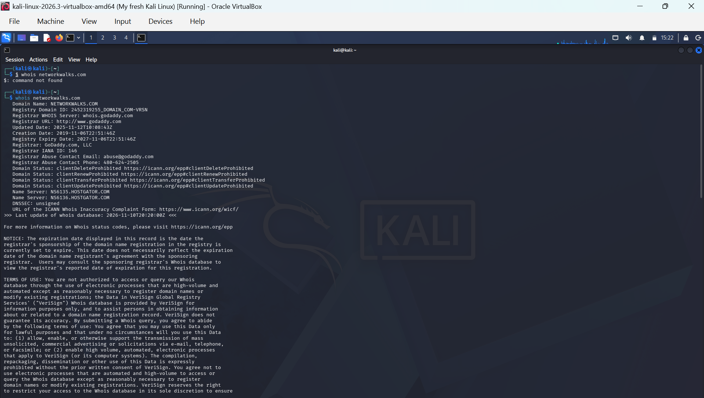
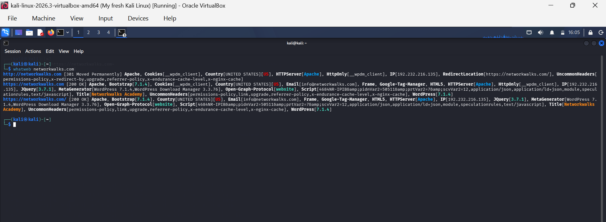
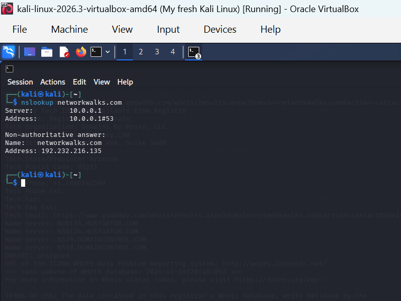
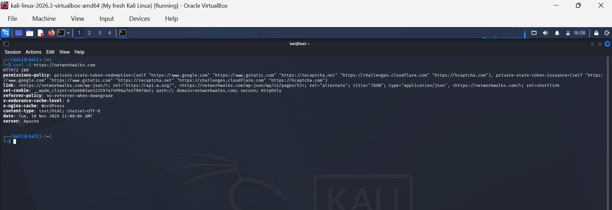
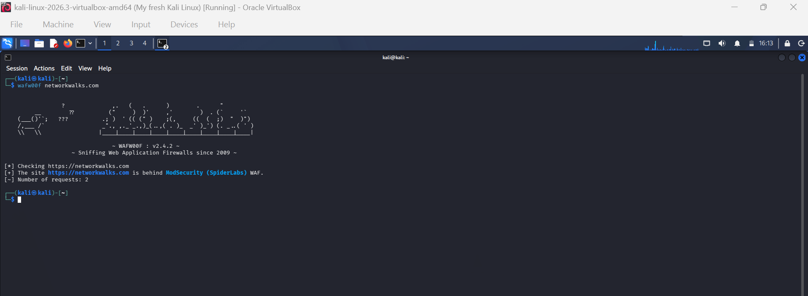
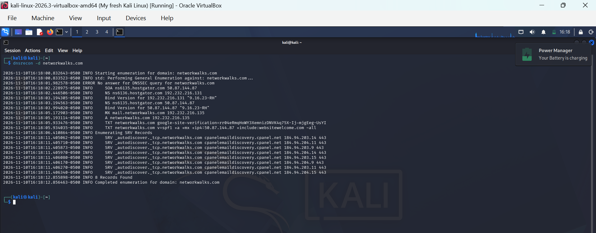
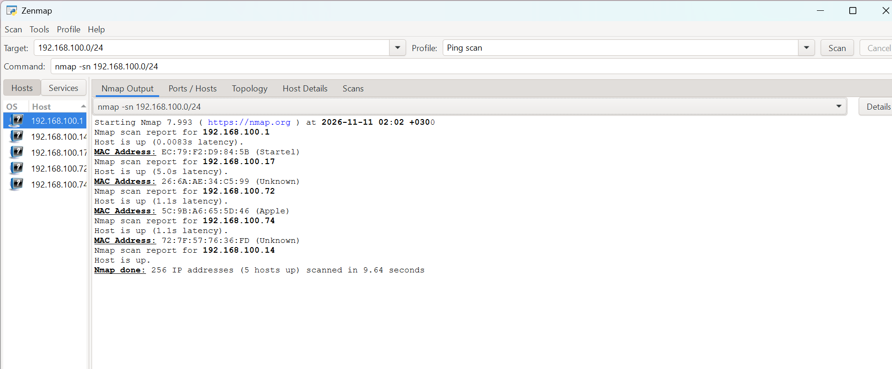
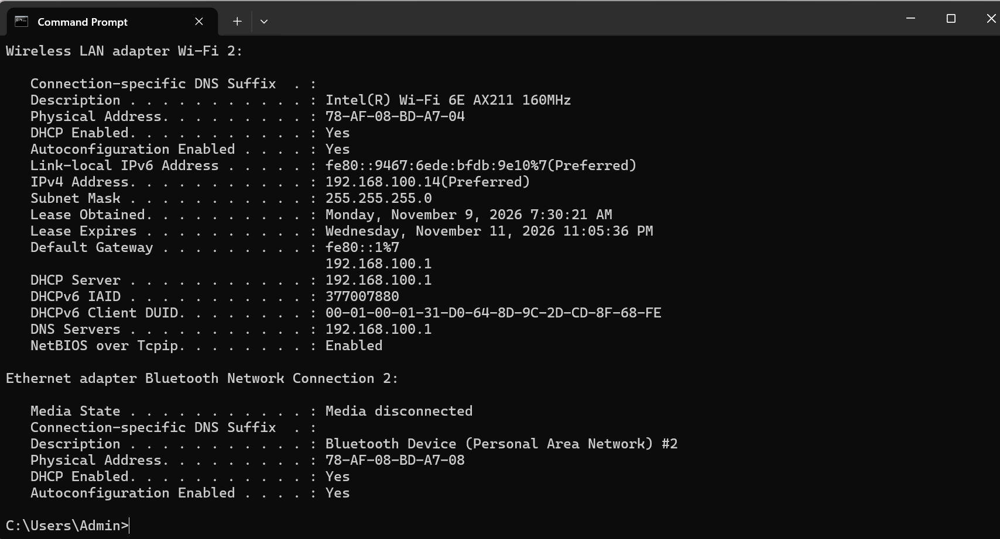
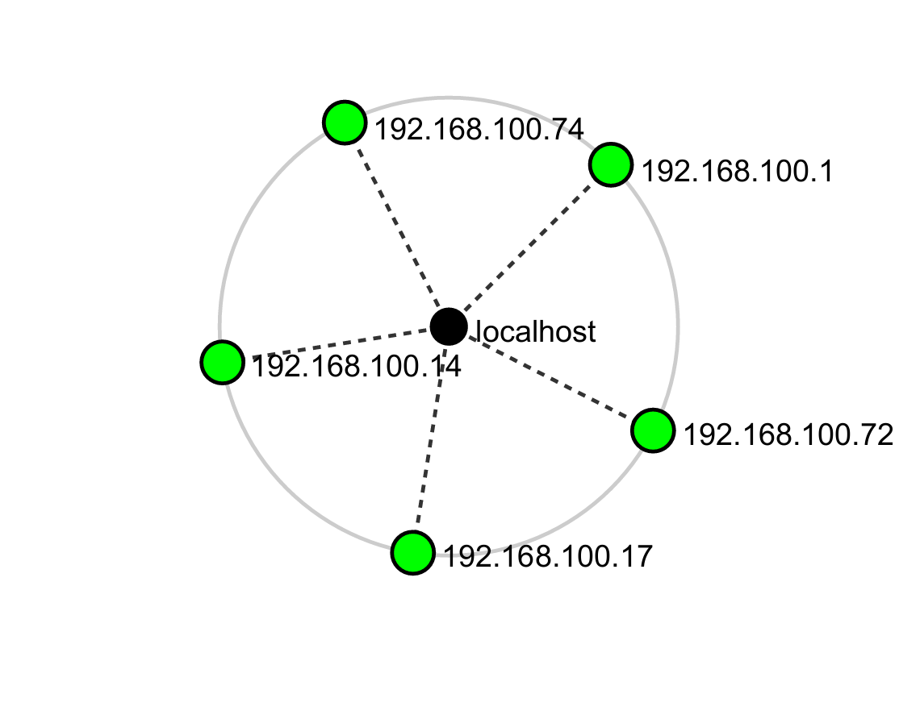

# Footprinting & Network Scanning Lab

A hands-on penetration-testing project covering **Phase 1 (Reconnaissance & Footprinting)** and **Phase 2 (Scanning & Network Discovery)**. It shows how an attacker moves from gathering public information about a domain to mapping live hosts on a network, and what a defender should do about each finding.

**Author:** Jacinta Kawila Nzuki

**Program:** Cybersecurity & Ethical Hacking Internship, Networkwalks (Batch B084)

**Report date:** 11 November 2026

**Modules:** W2-PM1 (Multiple Kali Tools) and W2-PM5 (Zenmap Scanning)

[View the full report (PDF)](<W2-PM-FINAL - Penetration Testing Report.pdf>)

---

## Legal & ethical notice

All activity was performed only on systems I had **written permission** to test (networkwalks.com, as part of the internship) or that I **own** (my home LAN).
---

## Project overview

| Phase | Target | Tools | Goal |
|---|---|---|---|
| 1. Footprinting | `networkwalks.com` | WHOIS, WhatWeb, nslookup, curl, wafw00f, DNSRecon | Collect public info about registration, tech stack, IP, headers, WAF and DNS |
| 2. Scanning | Local LAN (`192.168.100.0/24`) | Zenmap (Nmap GUI), Windows `ipconfig` | Discover live hosts, IPs, MAC addresses and a topology map |

Phases 3-5 of the wider program are still in progress and not part of this repo yet.

## Tools used

| Tool | Purpose |
|---|---|
| Kali Linux (VirtualBox) / Windows | Operating environments |
| `whois` | Domain registration details, name servers |
| `whatweb` | Web technology fingerprinting |
| `nslookup` | Domain-to-IP resolution |
| `curl -I` | HTTP response headers |
| `wafw00f` | Web Application Firewall detection |
| `dnsrecon` | DNS record enumeration (NS, MX, SPF/TXT, SRV) |
| Zenmap / Nmap 7.93 | Ping scan, host discovery, topology |
| `ipconfig` | Local IP and subnet identification |

## Key results

### Phase 1: Footprinting `networkwalks.com`

- **WHOIS:** registered via GoDaddy, DNSSEC unsigned, name servers on HostGator.

- **WhatWeb:** WordPress and the WP Download Manager plugin identified, plus Apache, jQuery, Bootstrap and Google Tag Manager.
  

- **nslookup:** resolves to `192.232.216.135`.
 

  
- **curl -I:** headers exposed the WordPress REST API endpoint `/wp-json/`.
  

- **wafw00f:** site sits behind **ModSecurity (SpiderLabs)**.

- **DNSRecon:** name server, mail server, SPF/TXT and service records enumerated.

### Phase 2: Zenmap scan of the LAN

Command: `nmap -sn 192.168.100.0/24` (Ping Scan profile). 256 addresses scanned in 9.64 s, **5 hosts up**:

| IP | MAC vendor (OUI) |
|---|---|
| 192.168.100.1 | Startel |
| 192.168.100.14 | n/a (no MAC listed) |
| 192.168.100.17 | Unknown |
| 192.168.100.72 | Apple |
| 192.168.100.74 | Unknown |

## Risk summary

These are **observations, not confirmed vulnerabilities**. No exploitation or vulnerability validation was done in these modules.

| # | Finding | Level |
|---|---|---|
| 1 | Web technology / plugin information exposed | Medium |
| 2 | Server IP address identifiable | Low |
| 3 | HTTP headers and `/wp-json/` exposed | Low |
| 4 | WAF technology identifiable | Low |
| 5 | DNS infrastructure information exposed | Medium |
| 6 | Multiple live hosts visible on local network | Medium |

## Recommendations

1. Review what technology, CMS and plugin information is publicly visible.
2. Keep CMS, plugins and web technologies updated against current advisories.
3. Review HTTP headers and remove unnecessary technical detail.
4. Review DNS records periodically.
5. Keep the WAF (ModSecurity) enabled and tuned.
6. Run regular internal network discovery scans.
7. Investigate any unknown device found on the network.
8. Maintain up-to-date network topology documentation.
9. Only test with proper authorization.

## What I learned

- Public information alone reveals a lot about an environment before any exploitation.
- A good report states what was done, what was found, what it means, the risk, and the fix.
- A version number or IP does not by itself mean a system is vulnerable; further authorized testing is needed to confirm.
- Scope and authorization always come first.

## Author: Jacinta Kawila

## Linkedin: https://www.linkedin.com/in/jacinta-kawila/

